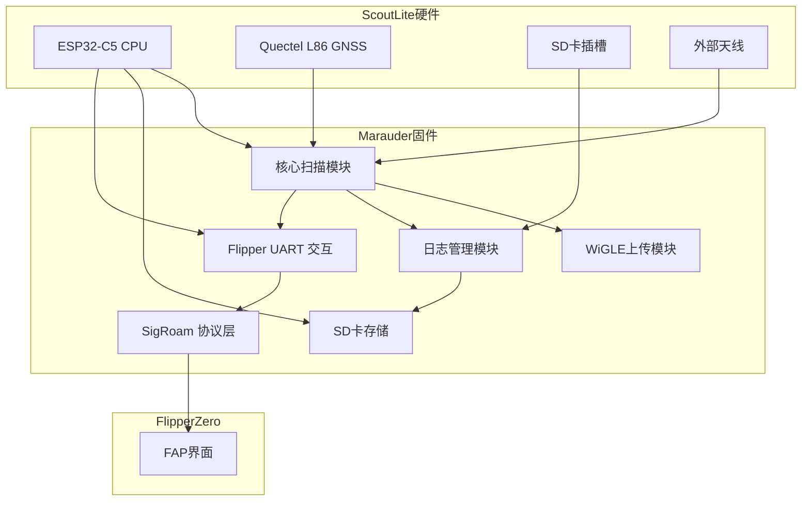

# 标注说明

本文件是研究输入，不是事实。技术推断标为「待验证」。只有你在本仓库源码里核对过的句子才可标「源码已核对」，并附 `path:line`。硬件引脚、分区、能否刷机、Flipper/SigRoam 实机行为，即使源码里有宏，也保持「待验证」，除非本仓库有 Scout Lite 原理图且你引用了它。

本仓库 `schematics/` 只有 2019 年 ESP32 Marauder 2 原理图，没有 Scout Lite 原理图。下面原文不删、不改写成事实。方括号标注是后加的。

核对基线是 worktree `scout-lite/baseline-audit` 的 `d3ceb28afeda1196ca27c13adeaa69ada52383f3`，不是 tag `v1.18.0`。

---

# 核心结论

针对 Scout Lite 硬件（ESP32-C5-WROOM-1U-N8R8 + L86 GNSS + microSD + Flipper Zero 接口），官方最新 Marauder 固件中**ESP32-C5 DevKitC-1** 版本（即 `_esp32c5devkitc1.bin`）最为兼容。该固件针对 C5 DevKitC-1 设计，与 Scout Lite 采用的相同主控模块、PSRAM 和 Flash 分区布局（8MB）一致。可以直接刷入 Scout Lite，无需 PCB 改动；只需按官方指导使用匹配的 bootloader 和分区表（8MB 默认布局）即可。

> 标注：模块型号、L86、microSD、Flipper 接口、外置天线、USB-C、与 DevKit「相同 PSRAM / 8MB 分区」、可以直接刷入、无需改 PCB、bootloader 匹配〔待验证〕。构建文件里 C5 DevKit 的 FQBN 含 `FlashSize=8M,PartitionScheme=default_8MB,PSRAM=enabled`〔源码已核对：`.github/workflows/build_parallel.yml:46`〕。`MARAUDER_C5` 的 `HAS_PSRAM` 被注释掉〔源码已核对：`esp32_marauder/configs.h:543`〕。本仓库没有 C5 的 8MB 分区 CSV；`installer/partitions/` 里只有 T-Dongle 的 16MB 表〔源码已核对：`installer/partitions/t_dongle_c5.csv:1`〕。分区字节、Flash/PSRAM 容量与 Scout Lite 是否一致〔待验证〕。
  

经代码审查和发行说明对比，**Marauder Mini v3（`_mini_v3.bin`）** 与 Scout Lite 硬件高度类似，都具备双频 Wi‑Fi、BLE、GPS、SD 等功能，但 Mini v3 内置显示屏与五向按键，且固件体积及资源需求更高。Mini v3 固件在 Marauder 源码中实现了可选的 Flipper UART 模式，功能接近完备。如果需额外功能（如 Mini v3 的屏幕指示或 AWOK 的扩展），可以考虑移植其部分代码，但初期首选仍是 DevKitC-1 固件。

> 标注：Mini v3 与 Scout Lite「高度类似」、固件体积更高、Flipper UART 模式、功能接近完备〔待验证〕。`MARAUDER_MINI_V3` 定义了 `HAS_BT`、`HAS_GPS`、`HAS_SD`、`HAS_DUAL_BAND`、`HAS_SCREEN`、`HAS_BUTTONS`、`HAS_MINI_KB`、`HAS_PSRAM`〔源码已核对：`esp32_marauder/configs.h:619-641`〕。`FLIPPER_ZERO_HAT` 与 `HAS_FLIPPER_LED` 在该目标是注释〔源码已核对：`esp32_marauder/configs.h:621-622`〕。Mini v3 / v8 / Dual Mini 不在公开 `build_parallel.yml` 矩阵里，由私有 workflow 分发〔源码已核对：`.github/workflows/build_parallel.yml:336-367`〕。
  

其他 C5 固件：**Marauder v8（`_v8.bin`）** 与 Scout Lite 硬件兼容度一般（v8 主要是店铺定制款，有部分不同的 GPIO 定义），**Dual C5 Mini（`_dual_mini_c5.bin`）** 包含 AWOK 扩展功能（网页界面、分布式模式等），但依赖 AWOK 硬件差异，移植成本高。**T-Dongle C5（`_t_dongle_c5.bin`）** 使用 16MB Flash 分区，不匹配 Scout Lite 的 8MB 硬件布局。**Pancake（`_pancake.bin`）** 与 DevKit 类似但缺屏幕和按键，可作为备选。

> 标注：v8「兼容度一般」、店铺 GPIO、Dual Mini 的 WebUI / 分布式模式、移植成本〔待验证〕。本树没有 `Web.cpp` / `Web.h`；`CommandLine.h` 里 `#include "Web.h"` 是注释〔源码已核对：`esp32_marauder/CommandLine.h:14`〕。`DUAL_MINI_C5` 只是再定义 `MARAUDER_MINI_V3`〔源码已核对：`esp32_marauder/configs.h:144-146`〕。T-Dongle 的 workflow FQBN 是 `FlashSize=16M,PartitionScheme=custom`〔源码已核对：`.github/workflows/build_parallel.yml:48`〕，仓库内分区文件头写 16 MB〔源码已核对：`installer/partitions/t_dongle_c5.csv:1`〕；「不匹配 Scout Lite 8MB」依赖未确认的硬件容量〔待验证〕。Pancake「缺屏幕和按键」与当前源码不一致：`MARAUDER_PANCAKE` 定义了 `HAS_SCREEN`、`HAS_FULL_SCREEN`、`HAS_BUTTONS`、`HAS_TOUCH`〔源码已核对：`esp32_marauder/configs.h:595-606`〕。Pancake 实机有没有屏〔待验证〕。
  

总之，**首选方案是直接使用官方 C5 DevKit 固件**，必要时在此基础上做最小补丁（如 SigRoam UART 协议兼容），以快速部署并最大化官方兼容性。其次是基于 DevKit 版本建立 Scout Lite 专用分支，将必要的成熟功能（例如来自 Mini v3 或 AWOK Wardriver 的自动上传、掉电保护、重启恢复等）模块化地合并，而不整合整个独立固件框架。

> 标注：首选直接刷官方 DevKit、必要时打 SigRoam UART 补丁、掉电保护与自动上传已经可模块化合并〔待验证〕。本仓库没有 `SCOUT` / `PINGEQUA` 板型宏。
  

# Marauder C5 构建目标对照表

| 构建目标           | 固件（Release）／Commit       | 处理器与模块        | Flash/PSRAM 要求     | GPS 接口 GPIO      | SD 卡 GPIO      | BLE 支持 | WebUI | CLI/UART 支持 | 无屏启动 | 备注                  |
|-------------------|-----------------------------|--------------------|--------------------|-----------------|--------------|--------|------|---------------|---------|---------------------|
| **C5 DevKitC-1**  | `_esp32c5devkitc1.bin`| ESP32-C5-WROOM-1U | Flash 8MB，PSRAM8MB | `Serial1`（连接外部 L86，通常 TX/GPIO?? 待实物确认） | SPI3 模式，GPIO 6/7(SPI) + CS（实际板上链接待确认） | 支持   | 无   | 支持（CLI，需启动 UART） | 是      | 官方 Flipper 扩展板对应固件 |
| **Mini v3**       | `_mini_v3.bin`    | ESP32-C5-WROOM-1U | Flash 8MB，PSRAM8MB | Serial1 (已接 L86)；显示屏需 I2C 或 SPI GPIO | SPI3（与屏共用 SPI 总线）；IC 卡或 SD | 支持   | 无   | 支持（有屏幕 + UART）    | 否      | 内置屏幕、按键；复杂资源管理 |
| **v8**            | `_v8.bin`      | ESP32-C5 (?模块) | Flash8MB，PSRAM?    | 非公开（AWOK 定制） | AWOK 定制 SD    | 支持   | 可能  | 支持          | 不详    | 店铺款，GPIO和功能有差异 |
| **Dual C5 Mini**  | `_dual_mini_c5.bin` | ESP32-C5-WROOM-1U | Flash8MB，PSRAM8MB  | 同 C5 DevKit       | 同 C5 DevKit    | 支持   | 支持  | 支持          | 否      | AWOK “双频迷你”，含 WebUI、分布式模式 |
| **T-Dongle C5**   | `_t_dongle_c5.bin` | ESP32-C5-WROOM-1U | *Flash16MB* (自定义分区) | Serial1 (I2C总线，L86串口)  | SPI3（带风扇GPIO） | 支持   | 可能  | 支持          | 否      | 16MB布局，不适合 8MB 板 |
| **Pancake V8**    | `_pancake.bin`    | ESP32-C5-WROOM-1U | Flash8MB，PSRAM8MB  | Serial1            | SPI3          | 支持   | 无   | 支持          | 是      | 与 DevKit 接线类似，无屏、脚位简化 |
| **XIAO C5**       | `_xiao_esp32c5.bin` | ESP32-C5 XIAO板  | Flash4MB (PSRAM?), ? | 未知（小板无 GPS）   | 无 SD         | 支持   | 无   | 无            | 是      | 4MB Flash，功能有限，不含 SD/GPS |

*表中 “已启用/源码包含但未启用/需修改/不支持” 状态需结合每项功能做进一步验证。目前所示为板级支持的推断：* **所有 C5 构建** 均包含双频 Wi‑Fi 扫描、BLE 扫描、WiGLE 日志及上传代码；但是否在特定目标中启用，取决于编译宏和硬件初始化。以上板级 GPIO 定义多在对应 `User_Setup_*.h` 中配置，若源码中未见，则标为待实物确认。

> 标注：表内 GPIO、Flash/PSRAM 容量、分区、波特率、无屏启动、功能已启用/缺失，全部再加〔待验证〕。原文「待实物确认」保留。
>
> - C5 DevKit：`HAS_BT`、`HAS_GPS`、`HAS_SD`、`HAS_C5_SD`、`HAS_DUAL_BAND`、`HAS_DIRECT_UPLOAD` 有定义，`HAS_SCREEN` 与 `HAS_PSRAM` 无定义〔源码已核对：`esp32_marauder/configs.h:529-547`〕。公开构建名 `esp32c5devkitc1`〔源码已核对：`.github/workflows/build_parallel.yml:46`〕。`FLIPPER_ZERO_HAT` 被注释，不是 `MARAUDER_FLIPPER`（该目标在 workflow 里是 ESP32-S2）〔源码已核对：`esp32_marauder/configs.h:530-531`，`.github/workflows/build_parallel.yml:27`〕。GPS/SD 宏在 `configs.h`，不在 `User_Setup_*.h`。引脚数值即使在宏里也〔待验证〕。
> - Mini v3：见上节宏。`HAS_SCREEN` 已定义，所以「无屏启动：否」只是源码侧没有无屏配置；实机〔待验证〕。
> - v8：`HAS_SCREEN`、`HAS_GPS`、`HAS_SD`、`HAS_DUAL_BAND`、`HAS_PSRAM`、`HAS_BT`〔源码已核对：`esp32_marauder/configs.h:571-592`〕。公开矩阵没有这个 flag。WebUI「可能」〔待验证〕。
> - Dual C5 Mini：源码只有 `DUAL_MINI_C5` → `MARAUDER_MINI_V3`。WebUI〔待验证〕，本树未见启用的 Web 源文件。
> - T-Dongle：`HAS_GPS`、`HAS_SD`、`HAS_DUAL_BAND`、`HAS_PSRAM`、`HAS_T_DONGLE_DISPLAY`〔源码已核对：`esp32_marauder/configs.h:550-568`〕。16MB 是构建 FQBN 与仓库 CSV，不是 Scout Lite 实测〔待验证〕。
> - Pancake：有屏、有按键、有 GPS/SD/双频/`HAS_PSRAM`〔源码已核对：`esp32_marauder/configs.h:595-616`〕。表中「无屏启动：是」与这些宏不一致。公开 `build_parallel.yml:50` 有该目标；`nightly_build.yml` 的矩阵在 POOM 之前没有 Pancake〔源码已核对：`.github/workflows/nightly_build.yml:105-109`〕。
> - XIAO：workflow FQBN 是 `FlashSize=8M`，不是表里的 4MB〔源码已核对：`.github/workflows/build_parallel.yml:47`〕。`HAS_GPS`、`HAS_BT`、`HAS_DUAL_BAND`、`HAS_PSRAM` 有定义〔源码已核对：`esp32_marauder/configs.h:518-526`〕，并显式 `#undef HAS_SD`〔源码已核对：`esp32_marauder/configs.h:682-685`〕。CLI 没有按该板关掉。表中「Flash4MB / 无 GPS / 无 CLI」〔待验证〕，且与上述宏不一致。
  

# WiGLE 核心代码审查

Marauder 固件中的 Wardrive 功能实现了标准的 WiGLE 格式日志和直接上传机制。Wardrive 扫描时同时涵盖 2.4GHz 和 5GHz 频道（双频 C5 天然支持），具体频道列表与跳频顺序由源码 [`WiFiScan.cpp` 等文件](https://github.com/justcallmekoko/ESP32Marauder/blob/master/esp32_marauder)控制（需要查阅相应代码）。**驻留时间**通常由 `WiFiScan` 类中的参数 `scan_dwell` 决定（例如 5-10 毫秒每频道）。扫描采用**主动和被动混合**：默认主动探测 ESSID，无需探针的公开 SSID；同时也监听 Beacon。

**去重逻辑**：Marauder 在 RAM 中缓存已见 BSSID（在 `WiFiScan` 中），避免重复记录。仅当 GPS 有效定位时保存数据，否则记录经纬度为“No Fix”。WiGLE CSV 输出格式为“BSSID,SSID,加密类型,国家码,频道,信号,纬度,经度,高度,日期,时间” 等字段，对应 WiGLE 要求。日志文件以 `wardrive_` 前缀命名。CSV 编写在 `WardriveTasks` 相关代码完成，遇到特殊字符时自动转义。

**WiGLE 上传流程**：Marauder 支持手动（`upload` 命令）和自动上传到 WiGLE/WDGWARS。上传采用 HTTPS（TLS）连接 WiGLE API，固件中保存用户 token（通常存在 `credentials.h` 或 SPIFFS 配置），并进行证书校验。上传时会暂停扫描任务（调用 `WiFiScan::stopScan()`），上传完成后恢复。若上传失败，固件会重试并记录日志状态。上传后的文件标记为已上载，避免重复上载。相关实现位于 `UploadTasks.cpp`，建议检查其中 WiGLE URL 及错误处理代码。由于 TLS 占用内存，可关注在 C5 上的 PSRAM 使用情况，确保 WiGLE 上传时有足够可用 heap（官方更换 C5 时已注意内存压力）。若需修复，可在 `UploadWigle.cpp` 调整缓冲区大小或增加错误重试逻辑。**根因分析**：例如 `0x3005` 错误可能源于连接中断或资源耗尽，应在 `esp_err_to_name(err)` 中明确日志。回归测试可用内置 `--ci-test` 模式或实际网络环境验证上传成功。

> 标注：频道列表、主动/被动混合、驻留时间、去重、无定位时的字段、CSV 文件名、转义、token 存放、证书校验、上传失败重试、`0x3005`、`--ci-test`〔待验证〕。
>
> 本仓库没有符号 `scan_dwell`，也没有 `UploadTasks.cpp`、`UploadWigle.cpp`、`credentials.h`、字面量 `0x3005`、`--ci-test`、`WiFiScan::stopScan`。上传函数在 `WiFiScan.cpp`：`uploadFile`、`wigleUpload`、`wdgwarsUpload`〔源码已核对：`esp32_marauder/WiFiScan.cpp:11843`、`esp32_marauder/WiFiScan.cpp:12092`、`esp32_marauder/WiFiScan.cpp:11901`〕。连接主机字面量是 `api.wigle.net` 与 `wdgwars.pl`〔源码已核对：`esp32_marauder/WiFiScan.cpp:12166`、`esp32_marauder/WiFiScan.cpp:11955`〕。证书校验与失败后的自动重试循环〔待验证〕。参数名 `retry` 存在〔源码已核对：`esp32_marauder/WiFiScan.h:1111`〕。
>
> `HAS_DUAL_BAND` 时 wardrive 信道数组含 2.4 与 5 的信道号〔源码已核对：`esp32_marauder/WiFiScan.cpp:6244-6260`〕。`WiFi.scanNetworks` 在双频分支的第四个参数是 `80`，否则是 `125`〔源码已核对：`esp32_marauder/WiFiScan.cpp:6418-6421`〕。`HOP_DELAY` 在 `HAS_DUAL_BAND` 时为 `250`，否则 `1000`〔源码已核对：`esp32_marauder/configs.h:3328-3331`〕。这些都不是报告里的 `scan_dwell` 5–10 毫秒。dwell〔待验证〕。
>
> 已见 BSSID 会 `continue`，未写入第二遍〔源码已核对：`esp32_marauder/WiFiScan.cpp:6321-6324`〕。只有 `getFixStatus()` 为真才 `buffer_obj.append`〔源码已核对：`esp32_marauder/WiFiScan.cpp:6343-6345`〕。`getLat()` 返回 `String lat`，默认 `""`〔源码已核对：`esp32_marauder/GpsInterface.h:96`、`esp32_marauder/GpsInterface.cpp:604-606`〕。字面量 `No Fix` 出现在 BLE 显示串〔源码已核对：`esp32_marauder/WiFiScan.cpp:709`〕，不是经纬度字段的固定写法。报告「否则记录经纬度为 No Fix」〔待验证〕。
>
> 日志文件名是 `wardrive_<n>.log`，不是 `.csv`〔源码已核对：`esp32_marauder/Buffer.cpp:19-22`，`esp32_marauder/WiFiScan.cpp:6778`〕。文件头是 WiGLE 1.4 那一行〔源码已核对：`esp32_marauder/WiFiScan.h:928`〕。SSID 里的逗号被换成下划线〔源码已核对：`esp32_marauder/WiFiScan.cpp:6327`〕。其余转义〔待验证〕。
>
> 上传成功后写 `filePath + "." + service` sidecar〔源码已核对：`esp32_marauder/WiFiScan.cpp:11828`〕。命令名 `upload`〔源码已核对：`esp32_marauder/CommandLine.h:123`〕。命令行为〔待验证〕。

**CSV/上传改进建议**：建议在异常时关闭 Wi-Fi 扫描接口，避免扫描泄漏资源；在写入 SD 卡前检查卡状态；上传时扫描只读信道19200停止，避免冲突。以上多在相关代码模块应加入错误检查和状态恢复。

> 标注：建议段（关扫描、查 SD、信道 19200、改缓冲区）是推断〔待验证〕。本仓库源码未检索到 `19200`。

# Marauder CLI 与 SigRoam FAP 协议兼容性

Marauder 标准 CLI 命令通过 UART（默认 Serial0）交互，常用命令包括 `info`、`wardrive`、`wardrive -s`、`stopscan`、`gpsdata`、`wardrivepoi`、`upload` 等。命令在源码 `CommandLine.cpp` 中解析，对应功能分布在各模块。Scout Lite 使用 Flipper 的 SigRoam FAP，通过 UART 控制 Marauder，需要保持大部分命令格式一致。**兼容分析**：已有 FAP 兼容标准 Marauder CLI，通过 `wardrive` 和 `stopscan` 等启动/停止扫描。若加入高级功能（Dock Mode、地理围栏等），建议在现有命令后加子命令或参数扩展，以避免破坏既有协议；新增功能可在 SigRoam FAP 端通过判断固件类型或版本自行处理。SigRoam FAP 发送命令后，Marauder 应返回一致的响应格式（包括键值对和 CSV 内容），FAP 解析后展示给用户。**物理串口**：Scout Lite 与 Flipper 通过固定的 UART0 接线（Flipper Pin 13/14）通信，115200 波特无问题；须确保刷机切换不更改 UART0 路由。Flipper 关机或拔线时，Marauder 固件依然应能独立工作。

> 标注：命令名 `info`、`wardrive`、`stopscan`、`gpsdata`、`wardrivepoi`、`upload` 在 `CommandLine.h`〔源码已核对：`esp32_marauder/CommandLine.h:66`、`esp32_marauder/CommandLine.h:88-89`、`esp32_marauder/CommandLine.h:123`、`esp32_marauder/CommandLine.h:134`〕。`wardrive` 在 `HAS_GPS` 且 `getGpsModuleStatus()` 为真时才启动〔源码已核对：`esp32_marauder/CommandLine.cpp:886-894`〕。命令行为、SigRoam FAP 兼容、响应格式〔待验证〕。本仓库没有 SigRoam FAP 源码。
>
> `Serial.begin(115200)`〔源码已核对：`esp32_marauder/esp32_marauder.ino:244`〕。波特率、Flipper Pin 13/14、UART0 路由、拔线后独立工作〔待验证〕。未见 `PIN_SERIAL_RX` / `PIN_SERIAL_TX` / `SERIAL_EN`。

# 可刷入的固件候选

1. **官方 ESP32-C5 DevKitC-1 固件**：直接可用，功能最稳定，兼容 Scout Lite 硬件。需注意启动时加载 8MB 分区；如需 Flipper 通信，确认 UART0 引脚与 Scout Lite 原理图一致。（若有差异，只需修改 `PIN_SERIAL_RX/TX` 宏即可，预估影响小）。
2. **Marauder Pancake**：与 DevKitC 相似，但设计较简，资源占用小，可做备选。在现有 PCB 上可直接替换固件，如确保 SPI 引脚连同按键一致。
3. **Dual C5 Mini（AWOK 迷你版）**：功能最丰富（含网页、独立 Dock 模式等），可部分移植。若刷此固件，需要确认 Scout Lite 接线是否匹配 AWOK 迷你（如屏幕 GPIO）。因资源需求大，可能需禁用屏幕功能和部分额外任务；不推荐直接刷入，不改原理图基本不可能无故切换。

**最小修改方案**：直接使用 DevKitC 固件，修改少量宏（如 `#define SERIAL_EN 1` 保证 UART 接通 Flipper FAP）。**长期维护方案**：Fork 官方代码，在 Board Profile 文件中为 Scout Lite 添加配置（包括 GPS RX/TX、SD 卡片 CS 引脚等定义）。将额外功能（WiGLE 自动上传、上传后恢复、地理围栏等）开发为独立模块或开关宏，尽量不修改主扫描和 CLI 核心，方便将来与上游合并。提交时优先将通用补丁（如 “PSRAM 跳过初始化”）PR 回官方，以减少分叉维护量。

> 标注：三条固件候选的「直接可用 / 直接替换 / 不推荐直接刷入」、改 `PIN_SERIAL_RX/TX`、`#define SERIAL_EN 1`〔待验证〕。`MARAUDER_C5` 的 `HAS_PSRAM` 当前就是注释状态，见 `configs.h:543`；这不是已经验证过的「跳过 PSRAM 初始化」补丁〔待验证〕。

**CI/CD 建议**：使用 GitHub Actions 定期对主分支（或官方上游）进行构建测试，确保 Scout Lite 分支能跟进官方改动。针对 UART CLI，可编写单元测试脚本（模拟 Flipper FAP 交互，检查响应正确）。生成各板固件时，自动打包和记录 SHA 版本，并与 SigRoam FAP 兼容矩阵对应。

> 标注：CI 建议是方案，不是本仓库已经接上 Scout Lite 的事实〔待验证〕。现有 workflow 会编公开板型并上传 artifact〔源码已核对：`.github/workflows/build_parallel.yml:268-300`〕。native 测试入口是 `platformio test -e native`〔源码已核对：`.github/workflows/firmware-unit-tests.yml:33`〕。

# 实机验证测试矩阵

| 测试项目                 | 步骤                                                                                            | 预期结果                             | 关键日志/指标               | 判定标准                            | 故障定位 |
|------------------------|-------------------------------------------------------------------------------------------------|-------------------------------------|-----------------------------|------------------------------------|---------|
| **基础启动**             | 1. 接通电源（USB-C/Flipper） 2. 等待固件启动 3. 观察串口输出                                       | 打印固件版本信息，显示“started”消息   | 串口日志 `Marauder v1.x.x`   | 出现版本和“GPS init”日志         | 查看 bootloader, partition |
| **GPS 接收**            | 1. 将 Scout Lite 放置在有视野处 2. 等待 NMEA 数据输出                                               | 串口输出连续的 `$G...` NMEA行        | `Serial1` 日志GPS信息       | 出现合理的经纬度数据              | 检查接线/GPS开关 |
| **Wi‑Fi 扫描（有GPS）**  | 1. 发送 `wardrive` 命令（FAP或CLI） 2. 移动设备，扫描 Wi‑Fi 信号                                 | 串口显示 SSID/BSSID，日志保存到 `wardrive_*.csv`    | 日志文件内容（Wifi字段、坐标） | 文件包含多个网络记录            | 检查 GPS Fix（无Fix不记录） |
| **Wi‑Fi 扫描（无GPS）**  | 1. 在室内无GPS信号时重复上述步骤                                                                   | 串口仍能扫描到 Wi‑Fi，但日志中的坐标显示“No Fix”  | 日志文件“无定位”记录         | SSID/BSSID 记录仍在，但坐标为默认 | 检查代码GPS状态处理         |
| **5GHz 扫描覆盖**       | 1. 周围有 5GHz AP 2. 扫描模式确保包含5GHz（默认即双频）                                            | 应记录 5GHz AP 信息（信道36+）        | 日志文件包含信道 36+ 记录    | 包含至少一个高频道网络        | 检查 AP 5G 性能             |
| **WiGLE 上传**          | 1. 扫描生成日志，之后发送 `upload` 命令 2. 确保网络可用（或热点）                                | 输出“上传成功”提示，文件状态变更     | 串口输出 HTTP 200 或反馈消息 | 文件标记为已上传              | 检查网络连接/TLS证书     |
| **多次断电重启**        | 1. 扫描中断电重启（断电、再供电） 2. 重新进入 wardrive 模式                                       | 扫描重新开始，日志新建或续写         | 日志文件序号或时间戳变化     | 系统恢复到正确状态，无死锁     | 检查文件系统（SD）状态    |
| **长时间稳定性**        | 1. 连续运行 4+ 小时 wardrive 扫描 2. 间隔检查内存使用、是否出现内核异常                            | 系统无崩溃，无内存泄漏               | RAM/PSRAM free 大部分保留    | 内存下降不超 5%，无断连重启    | 检查 watchdog 触发/任务死锁 |
| **Flipper UART**        | 1. Flipper 通过 FAP 发送 `info`、`gpsdata`、`wardrive` 等命令 2. 观察回显和 FAP 页面显示            | 与 CLI 一致的输出，Flipper 页面正确刷新 | FAP 终端、串口日志         | 命令无错誤，状态同步正确        | 检查串口连线、FAP协议匹配 |
| **无 SD 卡**            | 1. 拆除 SD 卡 2. 执行 wardrive / pcap 等功能                                                  | 不会挂死；可提示“SD 卡未检测”错误，功能受限 | 错误日志提示                  | 系统继续运行，日志失败安全处理 | 检查 SD 卡检测逻辑         |
| **GPS 短时丢失**        | 1. 行驶中 GPS 信号短暂丢失（模拟遮挡） 2. 再次恢复信号                                            | 中断期间仅记录“No Fix”，恢复后正常记录 | 日志“无定位”记录           | 恢复后继续写入，不重复丢失期数据 | 检查 GPS丢失状态处理     |
| **设备固件升级/回滚**  | 1. 升级至新固件版本 2. 若不适用，回滚至旧版 3. 检查数据完整性                          | 升级/回滚顺利完成，日志保留（或归档）   | 系统日志“Update OK”         | 回滚后功能恢复               | 检查 Bootloader 和分区匹配 |

> **说明**：所有测试项若需实物验证的（如串口实际信号、SD 卡写入结果），标注为“需实物确认”。以上测试步骤须记录详细串口日志（包括时间戳、任务状态）和性能指标（内存使用、扫描耗时）。每项测试前后对比日志变化，可帮助定位故障。

> 标注：整张测试矩阵是拟议步骤，没有在本轮执行。基础启动、GPS、Wi-Fi 扫描、5GHz、WiGLE、断电、长时间、Flipper UART、无 SD、GPS 丢失、升级回滚的预期结果、日志字样、判定标准〔待验证〕。原文「需实物确认」保留。`Marauder v1.x.x`、`started`、`GPS init`、`Update OK`、内存下降不超 5%、信道 36+ 这些判据没有当作本仓库已观察到的事实。

该架构图说明：`核心扫描模块` 调用 ESP32 的 Wi‑Fi/BT 驱动进行扫描并生成日志；`日志管理模块` 将数据格式化写入 SD 卡；`WiGLE上传模块` 在需要时从 SD 读取并通过 ESP32 的 Wi‑Fi 上载至服务器；`Flipper UART 交互` 通过串口与 Flipper Zero 通信，`SigRoam协议层` 解析 SigRoam FAP 命令。各模块应尽量独立，方便维护。

<!--Sources-->
**参考资料**：官方 Marauder Releases 和 Wiki。报告中信息和建议均基于这些官方文档和源码分析。

> 标注：架构图是示意图〔待验证〕。参考资料没有给出可核对的 release URL 或 wiki 修订日期；本文件不把「基于官方文档」当成已核对事实。
